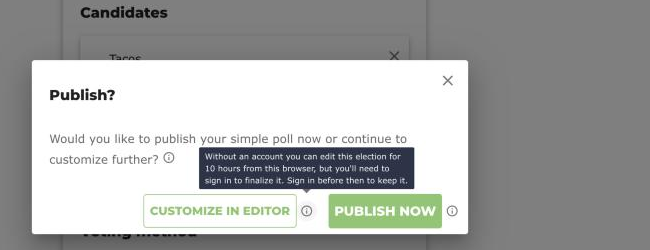
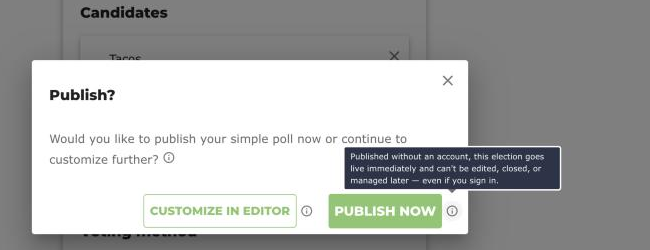
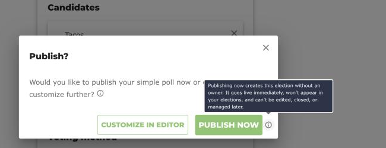

# Election Ownership, Temporary Access and Claim Keys

This page documents **who owns an election, how the backend decides that a
request comes from the owner, and what happens to elections created without
an account**. It describes the code as it is today — not how it should be.
Every claim cites a `file:line` so you can re-verify it after the code
moves; where something could not be settled from the code alone it is marked
**verify**.

Companion pages: [Voter Authentication Modes](6_voter_authentication_modes.html)
covers how *voters* are identified; [Per-Election `auth_key`](7_auth_key.html)
covers integrations that manage elections with an RSA key instead of an
account. This page is about the *owner* of an election created from the
web UI.

Line numbers below refer to `origin/main` at the time of writing.

## 1. Identity: how `req.user` is populated

Every `/API` route is mounted behind the `getUser` middleware
(`packages/backend/src/app.ts:60-62`). `getUser`
(`packages/backend/src/Controllers/User/auth.controllers.ts:12-19`) calls
`AccountService.extractUserFromRequest(req)` and, if it returns something,
sets `req.user`.

`extractUserFromRequest`
(`packages/backend/src/Services/Account/AccountService.ts:96-113`) tries two
cookies in order:

1. **`id_token`** (Keycloak). If present it is verified against Keycloak's
   public key via `AccountServiceUtils.extractUserFromRequest`
   (`AccountServiceUtils.ts:9-27`, RS256 for PEM keys). The decoded JWT
   claims become `req.user`; Keycloak sets `typ: 'ID'` and `sub` is the
   Keycloak user UUID. A bad signature throws `Unauthorized`.
2. **`temp_id`**. If there is no `id_token` but there is a `temp_id` cookie,
   `req.user` is set to the literal object
   `{ typ: 'TEMP_ID', sub: <cookie value> }` (`AccountService.ts:105-111`).
   Nothing is verified — the value is whatever the browser sent.
3. Neither cookie → `req.user` is `null` and `getUser` leaves `req.user`
   unset (`auth.controllers.ts:15-17`).

Note the precedence: if both cookies are present, `req.user` comes from the
`id_token`; the `temp_id` cookie is then **not** used for `req.user`, but it
is still read directly off `req.cookies` by the ownership check (section 2).

A third path exists for integrations: when the election row has an
`auth_key`, `electionSpecificAuth`
(`packages/backend/src/Controllers/Election/elections.controllers.ts:47-66`)
replaces `req.user` with the claims of the `custom_id_token` cookie verified
against that key. See [`7_auth_key.md`](7_auth_key.html).

### Where the `temp_id` cookie comes from

The backend never issues `temp_id`. The frontend mints it client-side with
`makeID(ID_PREFIXES.VOTER, ID_LENGTHS.VOTER)`, i.e. `v-` plus eight random
characters (`packages/shared/src/utils/makeID.ts:4,16,44-47`), and stores it
through `useCookie('temp_id', defaultTempId)`:

- `packages/frontend/src/components/Header.tsx:61-64` — runs on every page,
  so any visitor gets a `temp_id` cookie on first render (and a legacy
  value of `'0'` is replaced).
- `packages/frontend/src/components/ElectionForm/Wizard/Wizard.tsx:106-107`
  and `:118-122` — the wizard reads the same cookie and re-mints it if it is
  still `'0'`.
- `packages/frontend/src/components/Election/TemporaryAccessWarning.tsx:12-13`.

`useCookie` writes the default when the cookie is missing
(`packages/frontend/src/hooks/useCookie.ts:39-48`) and `setCookie` with
`hours = null` emits no `expires` attribute
(`useCookie.ts:3-11`), so **`temp_id` is a session cookie** — it is scoped
to the browser profile and goes away when the browser discards session
cookies. The same is true of the `<election_id>_claim_key` cookie
(section 3).

## 2. Roles: how the backend decides you are the owner

`electionPostAuthMiddleware`
(`elections.controllers.ts:68-123`) runs as a `router.param('id')` hook on
every `/API/Election/:id/*`, `/API/Ballots/:id/*` and `/API/Roll/:id/*`
route (`Routes/elections.routes.ts:876-877`, `ballot.routes.ts:290-291`,
`roll.routes.ts:423-424`). It builds `req.user_auth.roles` and then derives
`req.user_auth.permissions` from the role list with `getPermissions`
(`elections.controllers.ts:114`;
`packages/shared/src/domain_model/permissions.ts:39-50`).

The role derivation (`elections.controllers.ts:87-113`):

```ts
const ownerIsTempUser = !req.election.owner_id || req.election.owner_id.startsWith('v-');
const hoursSinceCreate = (now - create_date) / (1000 * 60 * 60)
const tempUserAuth =
    ownerIsTempUser &&
    req.election.owner_id == req.cookies.temp_id &&
    hoursSinceCreate < sharedConfig.TEMPORARY_ACCESS_HOURS &&
    hashString(req.cookies[`${req.election.election_id}_claim_key`]) === req.election.claim_key_hash;

if (req.user && req.election){
  if((req.election.owner_id == req.user.sub && req.user.typ !== 'TEMP_ID') || tempUserAuth){
    req.user_auth.roles.push(roles.owner)
  }
  if (req.election.admin_ids?.includes(req.user.email))      roles.push(roles.admin)
  if (req.election.audit_ids?.includes(req.user.email))      roles.push(roles.auditor)
  if (req.election.credential_ids?.includes(req.user.email)) roles.push(roles.credentialer)
}
```

Points to notice:

- **Nothing runs unless `req.user` is truthy** (`:100`). A request with no
  `id_token` and no `temp_id` cookie gets an empty role list, full stop.
- **Owner by account**: `owner_id == req.user.sub` *and* `req.user.typ !==
  'TEMP_ID'` (`:101`). The `typ` guard is what stops someone from editing
  their `temp_id` cookie to equal a victim election's `owner_id` — a
  `TEMP_ID` user can only become owner through `tempUserAuth`.
- **Owner by temporary access** (`tempUserAuth`, `:91-97`) requires all
  four of:
  1. `ownerIsTempUser`: `owner_id` is falsy (`null`, see section 5) **or**
     starts with `v-`. The comment at `:87-90` calls this a HACK — the
     prefix convention is the only way to tell a temp owner from a Keycloak
     UUID.
  2. `owner_id == req.cookies.temp_id` — loose equality, see below.
  3. `hoursSinceCreate < sharedConfig.TEMPORARY_ACCESS_HOURS`, which is
     **10** (`packages/shared/src/config/SharedConfig.ts:18`).
  4. `hashString(<claim_key cookie>) === election.claim_key_hash`.
     `hashString` is SHA-256 hex, and **returns `undefined` when its input
     is `undefined`** (`packages/backend/src/Controllers/controllerUtils.ts:46-49`).
- `tempUserAuth` does **not** look at `req.user` at all. It only reads
  cookies. So a *signed-in* user who still has the `temp_id` and claim-key
  cookies from creating the election also satisfies it — that is what makes
  the claim flow in section 4 work.
- Admin / auditor / credentialer are matched on `req.user.email`
  (`:104-112`). A `TEMP_ID` user has no `email`, so temp users can only ever
  be owner, never one of the other roles.
- `roles.system_admin` exists in `roles.ts` and in every permission list,
  but **no code path ever pushes it** onto `req.user_auth.roles`. The only
  reference outside `permissions.ts` is a read in `returnElection`
  (`elections.controllers.ts:194-197`). There is no sys-admin.

### The loose `==` and `owner_id: null`

`owner_id` has been nullable since PR #1446
(`packages/shared/src/domain_model/Election.ts:18`, validation at `:72-74`;
the column was always a nullable `varchar`,
`packages/backend/src/Migrations/2023_07_03_Initial.ts:14`). For an
ownerless row:

- `ownerIsTempUser` is `true` (`!null`).
- `owner_id == req.cookies.temp_id` is `null == <cookie>`. Any real
  `temp_id` cookie (a `v-…` string) makes this **false**. Only a request
  with **no** `temp_id` cookie makes it `true` (`null == undefined`).
- So the ownerless case reduces to: a request that carries a `req.user`
  (which, with no `temp_id` cookie, means a valid `id_token`), is within 10
  hours of `create_date`, and has a `<id>_claim_key` cookie whose hash
  equals `claim_key_hash`.

What protects an ownerless election from a visitor with no cookies at all is
the `req.user` check at `:100` — with neither cookie, `req.user` is unset and
no roles are assigned. What protects it from a *signed-in* visitor with no
`temp_id` cookie is condition 4: `claim_key_hash` must equal
`hashString(undefined)`, i.e. `undefined`. Whether that can happen depends on
what is stored:

- Elections created by the wizard **always** get a `claim_key_hash`
  (`Wizard.tsx:126-127`), including "Publish Now" ones, so the comparison is
  `undefined === '<sha256 hex>'` → `false`.
- Elections created through the API without a `claim_key_hash` are inserted
  with the field absent (`createElectionController.ts:13-42` passes the
  body through; `Models/Elections.ts:47-59` does `insertInto(...).values(election)`),
  so the column is SQL `NULL`. Subsequent reads go through Kysely /
  `node-postgres`, which surface `NULL` as JavaScript `null`, and
  `undefined === null` is `false`. **verify**: this last step relies on the
  driver's `NULL → null` mapping, not on anything in this repository. If a
  row ever came back with `claim_key_hash === undefined` (e.g. a column
  dropped from the select, or a mock DB), a signed-in visitor with no
  `temp_id` cookie would be granted `owner` on every ownerless election
  younger than 10 hours. There is no explicit guard for it in
  `electionPostAuthMiddleware`.

## 3. Claim key: what the wizard sets

`onAddElection` in `Wizard.tsx:117-138` is the single POST path for the
wizard. In order:

1. Ensure a `temp_id` cookie exists (`:118-122`).
2. If `election.owner_id != null`, set `owner_id` to the Keycloak `sub` when
   signed in, otherwise to the temp id (`:123-125`). The `!= null` guard
   exists so that a caller that passed `owner_id: null` keeps it null.
3. Generate `claimKey = crypto.randomUUID()` and store **only its SHA-256**
   in `election.claim_key_hash` (`:126-127`;
   `hashString` at `packages/frontend/src/components/util.tsx:85-87`). This
   happens for every wizard election, signed in or not, owned or ownerless.
4. POST the election (`:131`).
5. Set the cookie `<election_id>_claim_key = claimKey` with no expiry
   (`:135`) — the plain key never leaves the browser except inside the
   claim request in section 4.
6. Navigate to `/<election_id><subPage>` (`:137`).

The two buttons the user sees come from the `wizard.publish_confirm` dialog
(`packages/frontend/src/i18n/en.yaml:940-944`): `submit: 'Publish Now'` and
`cancel: 'Customize in editor'`. The dialog is raised by `onNext`
(`Wizard.tsx:148-164`) after the single-race form is submitted (the
multi-race path goes straight to `onCustomize`, `:61-99`, `:194`).

- **Customize in editor** (`confirmed === false`, `:161-162`) →
  `onCustomize` (`:140-146`): mode `open_unique_cookie`, state stays
  `draft`, `owner_id` is the default `'0'` from `makeDefaultElection`
  (`:32`) and therefore gets replaced in step 2 with the Keycloak `sub` or
  the temp id. Navigates to `/admin/build_ballot`.
- **Publish Now** (`confirmed === true`, `:159-160`) → `onAddElection` with
  **`owner_id: null`** and `state: 'finalized'`. Step 2 is skipped because of
  the `!= null` guard, so the election is **ownerless regardless of whether
  the user is signed in** (this was the explicit change in PR #1446). A
  `claim_key_hash` and claim cookie are still produced, but they can never
  satisfy `tempUserAuth` from this browser because the browser's own
  `temp_id` cookie makes condition 2 false (section 2). The election
  transitions `finalized → open` on its first GET because it has no
  `start_time` (`elections.controllers.ts:134-148`), and with no `end_time`
  it never auto-closes (`:150-159`). Navigates to the election home page.

Each button has an (i) icon whose tooltip states these consequences in plain
language (`wizard.publish_confirm_signed_out.*` and
`wizard.publish_confirm_signed_in.submit_hint` in `en.yaml`). Signed out, both
buttons get one; signed in, only Publish Now does, since Customize in editor
then behaves as a normal owned draft.







Dismissing the dialog (`confirmed === null`) does nothing (`:156-158`).

## 4. Claim / transfer: the only ownership-changing endpoint

There is exactly one endpoint that changes `owner_id` after creation:
`POST /API/Election/:id/claim` (`Routes/elections.routes.ts:149`),
implemented by `claimElection`
(`packages/backend/src/Controllers/Election/claimElectionController.ts:13-41`).
There is no `setOwner`, `transferOwnership`, or sys-admin override — `grep`
for those names finds nothing in `packages/backend/src` or
`packages/frontend/src`. `editElection` explicitly keeps `owner_id`,
`claim_key_hash` and `auth_key` from the stored row and ignores them in the
request body (`editElectionController.ts:12-16`), and `editElectionRoles`
only touches `admin_ids` / `audit_ids` / `credential_ids`.

`claimElection` requires, in order:

1. `permissions.canClaimElection` — `[system_admin, owner]`
   (`permissions.ts:26`). Since `system_admin` is never granted, the caller
   must **already be owner**, which for a temp-owned election means
   `tempUserAuth` must be true: temp id cookie equals `owner_id`, within 10
   hours, and the claim-key cookie hashes to `claim_key_hash`
   (`claimElectionController.ts:16`).
2. No-op if `owner_id == req.user.sub` (`:19-22`).
3. `req.user.typ == 'ID'` — i.e. an `id_token` is present; a `TEMP_ID` user
   is refused (`:25-27`).
4. `hashString(req.body.claim_key) == election.claim_key_hash` — the plain
   claim key must be sent in the body as well as the cookie (`:30-32`).
5. Then `owner_id = req.user.sub` and the row is rewritten with the reason
   `Transferring Ownership` (`:36-38`).

So yes: **a signed-in user can take ownership of a temp-owned election using
the cookies, but only from the browser that created it and only within
`TEMPORARY_ACCESS_HOURS`**. After that the permission check in step 1 fails
and the election can never be claimed.

Frontend side of the flow:

- `TemporaryAccessWarning` (`TemporaryAccessWarning.tsx:16-19`) renders on
  every admin page (`Admin/Admin.tsx:20`) only while `owner_id == temp_id
  cookie`, `hoursSinceCreate <= TEMPORARY_ACCESS_HOURS`, and the claim-key
  cookie exists. Its sign-in button stores the election id in
  `sessionStorage.election_to_claim` and opens Keycloak login (`:27-30`),
  which redirects to `/manage`.
- `ElectionsYouManage` (`Elections/ElectionsYouManage.tsx:19-45`) runs on
  `/manage`: once `isLoggedIn()`, if `election_to_claim` is set and the
  claim-key cookie exists it calls `useClaimElection`
  (`hooks/useAPI.ts:153-155`) with `{ claim_key }`, shows a snackbar and
  deletes the claim cookie. If the claim cookie is missing it silently clears
  `election_to_claim`.

Note that an **ownerless** (Publish Now) election never shows the warning
(`owner_id` is `null`, not the temp id) and, as discussed in section 2,
cannot pass step 1 from a browser that has a `temp_id` cookie. The only way
to claim one would be a hand-built request with the `id_token` and
`<id>_claim_key` cookies and *no* `temp_id` cookie, within 10 hours; the UI
never produces such a request.

## 5. Elections created via the API (`auth_key` integrations)

`createElectionController` does not derive `owner_id` from `req.user`; it
validates and inserts whatever the body contains
(`createElectionController.ts:13-42`, `controllerUtils.ts:12-26`).
`electionValidation` requires `owner_id` to be `null` or a string
(`Election.ts:72-74`). An integration following
[`7_auth_key.md`](7_auth_key.html) has no Keycloak `sub` to put there, so
the natural value is `owner_id: null` (**verify** what the discord bot
actually sends; issue #1434 reports the symptom for API-created elections
but does not show the payload). Such elections are **ownerless**:

- No Keycloak user can be owner: `owner_id == req.user.sub` at
  `elections.controllers.ts:101` is `null == <uuid>`, which is `false`.
- The integration itself gets `owner` through `electionSpecificAuth` + the
  `custom_id_token` JWT only if that JWT's `sub` satisfies
  `null == req.user.sub`, i.e. the JWT carries **no `sub`** — **verify**
  whether any integration relies on this; `customAuthKey.test.ts` does not
  exercise `owner_id`.
- They are not listed under "My Elections" for anyone (`getElections`
  filters on `owner_id = <sub>` or role e-mails,
  `getElectionsController.ts:18-23`, `Models/Elections.ts:143-160`).
- They cannot be managed from the web UI: the admin pages gate on
  `permissions` returned by `GET /Election/:id`
  (`Admin/AdminHome.tsx:37-40`), which are empty for everyone.
- Write-ins cannot be approved: `setWriteInResults` requires
  `canProcessWriteIns = [system_admin, owner, admin]`
  (`setWriteInResultsController.ts:57`, `permissions.ts:32`). This is
  issue #1434. A sibling change that refuses `enable_write_in` on races
  unless the election has a signed-in owner is in preparation — see the
  write-in restriction PR.

## 6. Consequences table

Each cell is derived from the code cited above. "Temp window" means: from
the browser that created the election, while it still holds both the
`temp_id` and `<id>_claim_key` session cookies, and `hoursSinceCreate <
10`. "Draft only" refers to `editElection`'s `state === 'draft'` check
(`editElectionController.ts:29-32`); the `finalize` endpoint also requires
`draft` (`finalizeElectionController.ts:21`).

| | **Signed in — Customize in editor** | **Signed in — Publish Now** | **Not signed in — Customize in editor** | **Not signed in — Publish Now** |
|---|---|---|---|---|
| `owner_id` | Keycloak `sub` (`Wizard.tsx:123-124`) | `null` (`Wizard.tsx:160`) | `v-…` temp id (`Wizard.tsx:118-124`) | `null` (`Wizard.tsx:160`) |
| Initial state | `draft` | `finalized`, auto-opens on first GET (`elections.controllers.ts:134-148`) | `draft` | `finalized`, auto-opens on first GET |
| Listed in "My Elections" | yes (`getElectionsController.ts:18-23`) | no — nobody's `sub` is `null` | no — `typ == 'TEMP_ID'` is skipped at `:23` | no |
| Who gets `owner` role | the account, forever (`elections.controllers.ts:101`) | nobody from the UI (see section 2/4 for the no-`temp_id`-cookie corner case) | that browser, during the temp window (`:91-97`) | nobody from the UI |
| Can be edited (`canEditElection`) | yes, draft only | no — no owner, and not draft | yes, draft only, during the temp window | no |
| For how long | unlimited | n/a | 10 h from `create_date` (`SharedConfig.ts:18`) | n/a |
| Can be finalized (`canEditElectionState`, `permissions.ts:25`) | yes | no — not draft | **no** — `finalizeElectionController.ts:19` calls `expectPermanentUser`, which throws `401 Create an account to finalize this election` when `req.user.typ === 'TEMP_ID'` (`controllerUtils.ts:37-41`). The UI says the same thing: `PublishAndShare.tsx:74` disables Finalize when `!authSession.isLoggedIn()` and shows "create a free account". The temp owner's draft can only be finalized after it is claimed (section 4). | no — not draft |
| Can be opened / closed (`setOpenState`, `canEditElectionState`) | yes | no — closes only via `end_time`, which Publish Now does not set | **backend: yes** during the temp window (the owner role is granted in full; only `finalize` checks for a permanent user). **UI: no** — a temp owner's election never leaves `draft`, so the admin open/close controls are moot, but a direct `POST /setOpenState` would succeed. | no — stays `open` indefinitely |
| Write-ins can be approved (`canProcessWriteIns`, `permissions.ts:32`) | yes | no (issue #1434 shape) | yes, during the temp window | no |
| Can be archived (`archiveElectionController.ts:16`, `canEditElectionState`) | yes | no | yes, during the temp window (backend; not surfaced for temp owners in the UI) | no |
| Can be deleted (`canDeleteElection`) | yes | no | yes, during the temp window (backend; not surfaced for temp owners in the UI) | no |
| Can be claimed by an account (section 4) | n/a (already owned) | no from the UI | yes, during the temp window, via the warning banner → login → `/manage` | no from the UI |
| After 10 h | unchanged | unchanged | **no one** has any role; the election is frozen in whatever state it was in | unchanged |

**verify** on the "Signed in — Publish Now" column: the behaviour follows
directly from `owner_id: null` at `Wizard.tsx:160`, but it means a
logged-in user who clicks "Publish Now" loses the election from their
account. That reads like an accident of PR #1446 rather than a product
decision; confirm with the maintainers before documenting it in end-user
help.

## 7. What expires, and whether anything can recover it

After `TEMPORARY_ACCESS_HOURS` (10) from `create_date`:

- `tempUserAuth` is permanently `false` (`elections.controllers.ts:96`), so
  the temp user drops to **no roles**. Every owner-gated endpoint —
  `edit`, `archive`, `setOpenState`, `delete`, `roles`,
  `setWriteInResults`, `sendInvites`, roll editing — returns
  `401 Does not have permission` (`controllerUtils.ts:28-32`,
  `auth.controllers.ts:21-31`). `finalize` was already refused during the
  window (`expectPermanentUser`, section 6); after it, the permission check
  fails first.
- The election can no longer be **claimed**, because `claimElection` first
  requires the `owner` role (`claimElectionController.ts:16`).
- `TemporaryAccessWarning` stops rendering (`TemporaryAccessWarning.tsx:19`),
  so the UI gives no hint that access was lost; the admin pages simply show
  the permissions error (`AdminHome.tsx:40`).
- Voting is unaffected — voter authorization is a separate path
  (`returnElection`, `elections.controllers.ts:183-188`).

Losing the cookies has the same effect earlier: both `temp_id` and
`<id>_claim_key` are session cookies with no `expires`
(`useCookie.ts:3-11`), so clearing site data, using another browser or
device, or a private window loses access before the 10 hours are up.

**Nothing in the codebase can recover an expired temp election or an
ownerless one.** There is no sys-admin role assignment, no "set owner"
endpoint, and `editElection` refuses to change `owner_id`. Recovery today
means a direct database update of `owner_id` on the head row.

## 8. How to verify

- Temp access end-to-end: `packages/backend/src/test/TestHelper.ts:308-313`
  shows how tests attach a `temp_id` cookie. At the time of writing no
  backend test exercises `claim_key_hash` or `/claim` (`grep -rn claim
  packages/backend/src/test` finds only JWT "claims"); add one there when
  touching `electionPostAuthMiddleware`.
- Reproduce the ownerless case locally: create an election via "Publish
  Now" (signed in or not), then `GET /API/Election/<id>` from the same
  browser and check that `voterAuth.roles` is `[]`.
- Reproduce the claim: not signed in, "Customize in editor", open the admin
  page, click the sign-in button in the temporary-access banner, sign in,
  and watch `POST /API/Election/<id>/claim` succeed from `/manage`.
- Reproduce expiry: set `TEMPORARY_ACCESS_HOURS` to `0` in
  `SharedConfig.ts`, rebuild `packages/shared`, and repeat the previous step
  — the claim returns 401.
